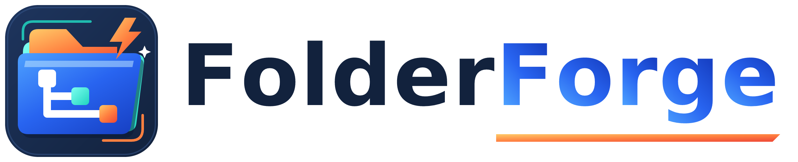
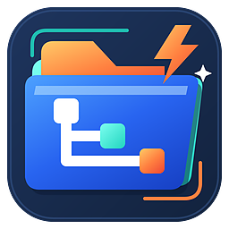

<p align="center">
  
</p>
<p align="center"><b>Skapa projektmappar med rätt struktur – på några sekunder.</b></p>
<p align="center">Windows · macOS · Linux &nbsp; | &nbsp; v0.0.2</p>

## Vad gör appen?

- **Skapa projekt** från din standardmall eller en tillfällig egen struktur.
- **Spara flera mallar** och välj vilken som ska vara standard.
- **Hitta tillbaka** till skapade mappar via historiken.
- **Exportera ett mappträd** som text, även med drag och släpp.
- Anpassa **ljust/mörkt tema, textstorlek och hög kontrast**.

<p align="center">
  
</p>

<p align="center">
   &nbsp;
   &nbsp;
   &nbsp;
   &nbsp;
   &nbsp;
  
</p>

## Kom igång

1. [Hämta senaste v0.0.2](https://github.com/Tokke2/FolderForge/releases/tag/v0.0.2) → **Source code (zip)**.
2. Packa upp **hela** mappen till en plats där du har skrivbehörighet.
3. Appen kräver **Python 3.11+ med PySide6 (Qt)** och paketen i `requirements.txt`.
   Om Python saknas kan startfilen erbjuda installation enligt nedan. Extra apppaket installeras inte av startfilen.
4. Starta enligt ditt operativsystem nedan.

**Ingen tyst installation, ingen automatisk Python-uppgradering och inga paketinstallationer vid vanlig start.**
Finns någon hittad Python erbjuds aldrig installation – även om den är gammal,
inte kan köras eller saknar GUI-paket. Bara när Python saknas visas ett erbjudande,
med **Nej/Avbryt som standard**. Ett nej hämtar och installerar ingenting.
Ingen separat `Installera senaste Python.bat` ingår och inget veckounderhåll körs.
Okända specialinstallationer utanför PATH/registrering/standardplatser kan inte
upptäckas säkert: avbryt erbjudandet om IT redan har en sådan installation.
På Windows provas systemets aktuella Python först (även 3.15). Om dess lokala
GUI-prov misslyckas väljs i första hand en redan installerad **3.14**, därefter
andra installerade Python 3.11+. Provet kontrollerar nödvändiga GUI-importer
samt en dold Qt-start, inte paketversioner eller tillgängliga uppgraderingar.
Vald och överhoppad tolk med orsak skrivs i `logs/folderforge.log`.
Om ingen fungerar avbryts starten utan konsolreserv eller installation.
Detta är ett Python-källkodspaket, inte en fristående signerad app.
På en arbetsdator: låt IT hantera installation och behörigheter.

### Windows

Dubbelklicka **`Starta-FolderForge.vbs`**.
Appen använder systemets `pythonw.exe`, startar dold i systemfältet och
öppnar inget konsolfönster som reserv.

### macOS

Dubbelklicka **Starta-FolderForge.app** direkt i den uppackade mappen.
Den kräver inte Python för att kunna visa erbjudandet och öppnar inte Terminal.
Om Python saknas och du godkänner används befintlig Homebrew (`brew install python`,
utan automatisk Homebrew-uppdatering). Finns inte Homebrew öppnas python.org för
manuell installation. Starta igen efter manuell installation. Appen installerar
inte Homebrew eller Apples utvecklarverktyg. Apples utvecklarstub utan installerade
verktyg räknas inte som en fungerande Python-installation.

### Linux

Öppna **Starta-FolderForge.sh** som program om filhanteraren stöder det, eller kör:

```sh
sh Starta-FolderForge.sh
```

Om Python saknas krävs Zenity eller KDialog för ett uttryckligt ja. Utan grafisk
dialog görs ingen installation. Med ditt ja används systemets paketkälla via
`pkexec`: apt, dnf, zypper eller pacman, inklusive Tkinter. Behörighetsdialog kan
visas; utan pkexec/stödd paketkälla hänvisas du till IT. Startaren kör inga
fjärrskript och uppdaterar inte paketlistor. Paketkällans version kan vara äldre
än senaste python.org, men appen kräver minst 3.11. macOS/Homebrew och Windows/winget
väljer den senaste stabila version som deras respektive källa erbjuder.

### Windows om Python saknas

Efter ett uttryckligt ja söker startfilen dynamiskt efter senaste stabila Python
3 i winget och visar dess installationsprogram (användarinstallation). Preview,
alfa, beta och RC väljs bort. Samtycket omfattar wingets käll-/paketvillkor.
Saknas winget öppnas python.org för manuell installation, först efter ditt ja.
Installation kan blockeras av IT-policy. Ingen befintlig Python tas bort eller
uppgraderas av FolderForge.

### Genvägar och beroenden

På macOS/Linux kan `python3 tools/create_shortcut.py` skapa en ikonbaserad genväg
som använder samma startfil: **FolderForge.app** respektive **FolderForge.desktop**.
Linux kan kräva att genvägen markeras betrodd. Startaren öppnar inte en ny terminal;
startar du själv från en terminal stängs den inte av appen. Loggar finns i `logs/`.
Om installationen avbryts eller misslyckas kan ett nytt erbjudande visas vid nästa
start så länge Python fortfarande saknas. **När Python hittas erbjuds det inte igen.**

Efter en ny Python-installation måste IT/användaren fortfarande ordna appens
beroenden enligt `requirements.txt`; startfilen installerar inte dessa automatiskt.
På macOS kan Gatekeeper och på Linux skrivbordets filregler kräva godkännande.
Det här är inte en signerad, fristående app och startfilerna kringgår inte IT-policy.

## Öppna och avsluta

**Appen startar alltid dold/minimerad.** Öppna den via FolderForge-ikonen i
systemfältet/menyraden. En extra start skapar inte en ny instans och visar
inte automatiskt huvudfönstret.

- **Öppna FolderForge** i ikonens meny visar fönstret.
- **Öppna appens mapp** öppnar installationsmappen utan att visa appfönstret.
- **Stäng/minimera** döljer fönstret igen.
- **Avsluta** i ikonens meny eller **Arkiv → Avsluta FolderForge** stänger appen helt.
- Linux X11 utan stöd för ikonmenyer: klicka på ikonen för att öppna, avsluta via Arkiv.
- Global snabbtangent är ett tillval och beror på skrivbordets behörigheter.

## Operativsystem och begränsningar

| | Windows | macOS | Linux |
|---|---|---|---|
| Projekt, mallar, historik och export | Ja | Ja | Ja |
| Startikon | Native startprogram | Genererad `.app` | Genererad `.desktop` |
| Dold start | Systemfält | Menyrad | Systemfält krävs |
| Inbyggd autostart-inställning | Ja | Använd OS inloggningsobjekt | Använd skrivbordets autostart |
| Global snabbtangent | Beror på policy | Kan kräva Hjälpmedel/Input Monitoring | X11; Wayland kan begränsa |

**Verifierat i CI:** Windows med Python 3.11/3.13/3.14, macOS med Python 3.13
samt Linux/X11 med Python 3.13, Xvfb och ett riktigt systemfält (stalonetray).
318 automatiserade tester och riktiga GUI-tester kontrollerar dold start,
dubbelstart, visa/dölj/avsluta samt fungerande och avsiktligt trasiga uppdateringar
med återställning och bevarade användardata.

[Windows-resultat](https://github.com/Tokke2/FolderForge/actions/runs/42612238314) ·
[macOS- och Linux-resultat](https://github.com/Tokke2/FolderForge/actions/runs/42612237680)

Detta verifierar inte alla macOS-versioner, Linux-skrivbord eller IT-policyer.

Linux behöver en grafisk session och ett fungerande systemfält. GNOME/Wayland
kan kräva en systemfältstillägg och/eller XWayland; ren Wayland stöds inte
fullständigt. Headless/server utan skrivbord stöds inte.
En genererad macOS-app är osignerad; företagets policy kan blockera den.
Appen kringgår inte Gatekeeper eller företagets säkerhetspolicy.

## Uppdateringar och dina filer

**Sök uppdatering nu** finns i huvudfönstret och ikonens meny.
Appen kontrollerar stabila GitHub-releaser var tolfte timme, även om
versionsnumret är oförändrat.

Före filbytet sparas en backup. Den nya appen måste bekräfta fungerande start;
vid misslyckande erbjuds återställning. Ingen upptagen process tvångsavslutas.
**Projekt, inställningar och historik återställs inte eller raderas.**

Vid manuell uppdatering: stäng appen, ersätt appfilerna och **behåll `data/`**.

## Om starten säger `No module named 'PySide6'`

Det saknade paketet finns inte i **den Python som startaren använder**.
En annan Python kan ha paketet utan att det hjälper den här starten.

1. Läs **Starttolk** och **Python=** i `logs/`. Där står den fullständiga sökvägen.
2. Vid importfel loggas ett manuellt kommando för just den tolken och appens
   `requirements.txt`. Kör det bara om din IT-policy tillåter det, annars be IT.
3. Starta sedan med `Starta-FolderForge.vbs` på Windows.

Det lokala GUI-provet väljer bara bland redan installerade tolkar. Ingen
nedladdning, paketinstallation eller uppgradering körs automatiskt.
Tkinter behövs endast för det uttryckliga Tk-reservvalet, inte för Qt.
Om appen inte kan öppnas kan dess uppdateringsknapp inte användas:
packa i så fall upp appfilerna från v0.0.2 manuellt och **behåll `data/`**.

## Felsökning

- Saknas appikonen? Kontrollera att hela `Icon/` följde med.
- Startar appen inte? Kontrollera befintlig Python/PySide6 och nödvändiga paket.
- Öppna **Hjälp → Fellista och felsökning**, eller läs `logs/folderforge-errors.log`.
- Inställningar, mallar och historik ligger i **`data/`**. Radera inte den mappen.
- Python kan fortfarande visas som processikon i Aktivitetshanteraren; appens
  egna ikoner ändrar inte systemets delade Python-programfil.

[Mer om funktioner, tangentbord och felsökning](docs/TEKNISK_GUIDE.md) ·
[Ändringar i v0.0.2](RELEASE_NOTES.md)

© 2026 **Rickard Längkvist**

### Fönster på flera skärmar
På Windows anpassas fönstren till en skärms arbetsyta i taget, inklusive utrymmet som aktivitetsfältet tar. Huvudfönstrets normala storlek och läge sparas automatiskt och justeras om en skärm kopplats bort. Appen startar fortfarande minimerad. På små fönster finns scrollning som reserv; text och knappar radbryts. Sparat läge kan nollställas genom att radera `data/window-placement.json` och dess eventuella `.bak`-/`.bak2`-kopior när appen är avslutad.

Placeringen sparas först när huvudfönstret är synligt i normalläge; minimerad start ändrar inte det sparade läget.

Navigeringen ligger i namngivna flikar ovanför innehållet. Flikarna får fler rader när fönstret är smalt eller texten förstoras. Vilka flikar som visas väljs fortfarande via Visa-menyn eller Inställningar.

Förslagsbank: [100 nya förbättringsförslag](docs/100_FORBATTRINGSFORSLAG.md). Förslag införs bara efter uttryckligt val. Felsökningspaketet innehåller även skärmmått, tillgängliga Windows-arbetsytor, DPI och textskalning, utan fönstertitlar eller skärmbilder.

Layoutmatrisen provar verkliga Xvfb-upplösningar 1366×768 och 1920×1080 samt 150 % textstorlek. Windows provar även 150 % textstorlek på runnerns skärm; test av fysisk flerskärms-DPI är fortfarande separat.

## Ny ikon och trycklogotyp
Samma vektormaster används i appen, systemfältet, Windows ICO och macOS ICNS.
- **Tryckoriginalen ingår i samma release-ZIP som appen**, i `Icon/`: `folderforge-logo.svg`, `folderforge-logo-inverse.svg`, `folderforge-logo-mono.svg` och `folderforge-symbol.svg`. Inget separat grafikpaket behöver hämtas.
- [Tryckguide, färger och begränsningar](docs/VARUMARKE_OCH_TRYCK.md)

SVG-originalen har konturiserade bokstäver och inga rasterbilder eller externa typsnittsberoenden. Färgerna är sRGB; tryckeriet behöver göra eventuell CMYK-/ICC-konvertering.
Huvudfönstrets X och minimera går till systemfält/menyrad på stödda skrivbord. Välj **Avsluta** för att stänga appen. Linux kräver kompatibel tray; Wayland stöds inte generellt.

Den aktuella färgstarka profilen kombinerar klarblått, turkos och orange mot mörk marinblå botten. Ordmärket är tvåfärgat; tryckoriginal och appikoner kommer från samma vektormaster.

Den senaste profilen använder vektorbaserat färgdjup, högdagrar och en orange blixt. Tray-varianten är avsiktligt enklare för liten storlek. Hela leveransen beskrivs i [RELEASE_INNEHALL.md](RELEASE_INNEHALL.md).

## Frivilligt stöd via Swish, PayPal och Ko-fi

**Hjälp → Donationer – Stöd FolderForge** visar en lokal QR-kod i Swishs C-format.
Fast mottagarnummer: **0721817177** (internationellt 46721817177).
Belopp är inte förifyllt; välj själv i Swish och kontrollera mottagarens namn
samt belopp innan betalningen godkänns. Inga funktioner låses bakom donation.
Appen behandlar inte betalningar och hämtar ingen betalstatus. Ingen extern
QR-tjänst används. QR-koden är offentliga betaluppgifter, inte kryptering.
Mottagaren kan inte ändras i appens gränssnitt eller inställningar, men en
källkodsdistribution kan inte göras manipulationssäker mot egen kodredigering.

I samma dialog finns fasta knappar för **PayPal Rickard3dPrint**
(`https://paypal.me/Rickard3dPrint`) och **Ko-fi tokke2**
(`https://ko-fi.com/tokke2`). De öppnar respektive betaltjänst i webbläsaren
först efter klick. Ingen separat stödsida eller inbäddad betalning används.
Belopp väljs hos betaltjänsten. Kontrollera alltid mottagaren innan betalning.

## Qt är standard – Tk är ett uttryckligt reservval

Vanliga startfiler öppnar nu **Qt**. De startar dolt med appikon i systemfältet.
Stäng och minimera döljer fönstret; **Avsluta** i systemfältet stänger processen.
En extra start visar inte det befintliga fönstret. Snabbtangenten kan däremot visa det.

Ingen automatisk växling till Tk och inga automatiska paketinstallationer görs.
För en uttrycklig reservstart: kör `Starta-FolderForge-Tk.py` med en befintlig
Python som har paketen i `requirements-tk.txt` samt Tkinter. Stäng först Qt via
systemfältet. Båda gränssnitten använder samma instanslås, inställningar, mallar
och historik. Reservvalet flyttar eller raderar inga projekt.

### Samlad felsökning

Under **Hjälp → Fellista och felsökning** finns bestående fel, feldetaljer,
system-/skärmkontroll och lokal diagnostikexport. Markera bara ett fel som löst
när orsaken verkligen är åtgärdad; det utför inte en reparation eller gör om en
misslyckad projektåtgärd. Utförliga loggar aktiveras separat under Hjälp.

- `logs/startup-diagnostics.json`: senaste startfasen, Python-/paketversioner och appfilernas kontrollsummor.
- `logs/folderforge-errors.log`: separat fellogg tills felen hanteras.
- `logs/folderforge.log`: vanlig logg; tidigare dagar arkiveras.
- Export skapar en **lokal ZIP**, efter godkännande. Ingenting skickas automatiskt.
  Kontrollera filen innan du delar den: vanliga loggar kan innehålla sökvägar och projektnamn.
- På Linux kräver Qt en fungerande grafikmiljö och Qt:s systembibliotek. Vid fel
  om `xcb` behöver IT kontrollera distributionens Qt/XCB-bibliotek; appen installerar inget.
- Autostart aktiveras uttryckligen under Inställningar, med bekräftelse. På Windows
  visas resultat per metod; på macOS/Linux skapas användarens inloggningspost.
  OS-behörigheter, macOS Accessibility och Wayland kan begränsa globala snabbtangenter.

Uppdateringar tillämpas under instanslåset och övervakas tills Qt bekräftat starten.
Automatisk omstart väntar medan en dialog är öppen, mall/inställningar är osparade
eller mappträdsinläsning pågår. Kontrollera ändå alltid det egna arbetet innan du
väljer manuell omstart.

Utvecklarunderlag och kvarvarande hårdvarukontroller: `docs/QT_PROTOTYP.md`.

## Profiler: mall + egen sparplats

Under **Mallar** kan du spara profiler. En profil består av ett namn, mappstrukturen
 och en fullständig sparplats. Välj en befintlig mall som utgångspunkt, skriv ett
 eget profilnamn, välj sparplats och tryck **Spara profil (mall + sparplats)**.
 Du kan till exempel ha ”Jobb” som sparar på arbetsplatsens disk och ”Privat” som
 sparar på en annan plats, med samma eller olika strukturer.

Välj **Profil / mall** när du skapar projektet. Slutlig sökväg visas före
bekräftelsen. **Använd vald profil som standard** väljer förvalet för nya projekt.
Äldre mallar utan egen sparplats använder den allmänna sparplatsen i Inställningar.
Inbyggda mallar ändras inte: spara en kopia under eget namn för en egen profil.
Profiler sparas atomiskt i samma JSON-fil som mallen under `data/templates/`.
Att spara en profil flyttar inga projekt och skapar inte dess projektmappar.

Det uttryckliga äldre Tk-reservgränssnittet behåller profilinformationen när en
mall redigeras, men använder fortfarande sin allmänna sparplats vid skapande.
Använd det ordinarie gränssnittet för profilspecifika sparplatser.

### Aktiv profil och standardprofil

På **Skapa** väljer du profil direkt och ser dess aktuella sparplats. Det senaste
profilvalet sparas automatiskt, även mellan omstarter. Samma profil förväljs i
projektdialogen. Profilval sparar inte andra osparade inställningar.

**Standardprofil** väljs under **Inställningar → Standardprofil**, följt av
**Spara inställningar**. Den används när ingen tidigare profil har valts, eller
när den senast valda profilen inte längre finns. Ett byte av standardprofil
skriver alltså inte över ditt senaste profilval.

Uppdateringsstatus visas alltid ovanför flikarna: kontroll, hämtning eller väntan
på omstart. Håll musen över statusen för senaste kontroll, hämtning och fel.
**Sök uppdatering nu** öppnar detaljer och installationsknappen. Primärknappen
**Skapa projekt** är tydligast; övriga åtgärder har en lugnare utformning.
